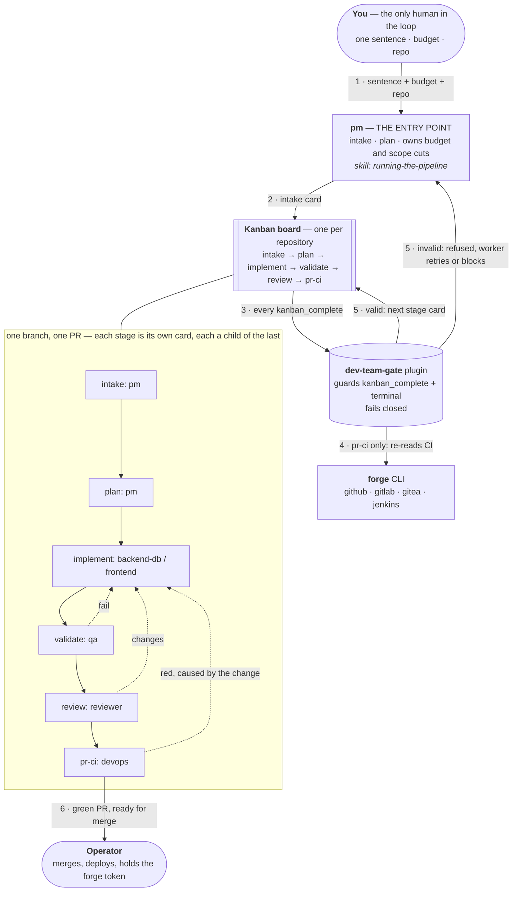

# dev-team: an autonomous software delivery team on Hermes kanban

Status: implemented, pending the CI workflow's own green run (`.github/workflows/dev-team.yml`
is in place; see [How it differs from `old/`](#how-it-differs-from-old)).

One sentence, a budget and a repository in. A pull request with green CI, marked ready for
human merge, out. No human in between unless a stop condition fires — merge and deploy are
always human, by design.

`dev-team` keeps Hermes kanban exactly as it is and adds what it doesn't have: an engine that
enforces "nothing is done without QA acceptance" instead of leaving it to an agent's judgment.
A change moves through six fixed stages. Each stage hands the next a small typed `metadata`
result. A stage cannot complete until that result is present and well-typed, and for CI, until
a fresh read from the forge confirms it. The full design, including what was rejected and why,
is in [`docs/superpowers/specs/2026-10-29-dev-team-design.md`](../docs/superpowers/specs/2026-10-29-dev-team-design.md).

## The pipeline



Rework loops back to a new `implement` card, not a fresh branch, up to a round limit of 3
(counted by the guard across the card's ancestry). A fourth round is refused; the worker must
block with `review: rounds-exhausted` instead.

## Profiles

Eight profiles, prefixed `dev-` by default (`--prefix` changes it) so they never collide with
`sdlc-team` or `outsourcing-team` profile names.

| Profile | Soul | Stages it works |
| --- | --- | --- |
| `pm` (entry point) | sdlc pm, unchanged | intake, plan — owns budget, scope cuts, reporting |
| `architect` | sdlc architect | plan (one-way-door decisions only, as a child card) |
| `uiux` | sdlc uiux | plan (when the change has an interface) |
| `backend-db` | sdlc backend-db | implement |
| `frontend` | sdlc frontend | implement |
| `qa` | sdlc qa | validate |
| `reviewer` | new | review |
| `devops` | sdlc devops | forge onboarding, pr-ci |

The reviewer soul is new: it reads the diff against the plan and acceptance criteria and judges
correctness, scope creep, risk and maintainability. It cannot approve its own work, write the
fix, or run the tests on the implementer's behalf.

## Stages

A stage is identified by the stage skill the card was created with
(`--skill dev-team-stage-<stage>`); the guard reads the stage from the card's skills, never
from its title or body. A card with no stage skill is not guarded at all.

| Stage | Assignee | Required `metadata` on `kanban_complete` |
| --- | --- | --- |
| `intake` | pm | `definition_of_done` (list), `budget` (`{amount, unit}`), `repo` |
| `plan` | pm | `cards` (ids of the implement cards it created, each verified to carry a stage skill) |
| `implement` | backend-db / frontend | `branch`, `head_sha`, `changed_files` (non-empty), `tests_run` (list of `{command, exit_code}`, at least one, every `exit_code` 0) |
| `validate` | qa | `head_sha` (must equal implement's), `verdict` (`pass`/`fail`), `evidence` (list); `fail` also needs non-empty `findings` |
| `review` | reviewer | `head_sha` (must equal validate's), `verdict` (`approve`/`changes`); `changes` also needs non-empty `findings` |
| `pr-ci` | devops | `pr_url`, `head_sha` (must equal review's), `ci` (`green`/`red`); `red` also needs non-empty `findings` — re-verified by the guard through `forge ci-status`, not taken on the worker's word |

**The pr-ci green/red rule, as the guard (`dev-team-gate/guard.py`) implements it:** a
`pr-ci` card claiming `ci: "green"` is not believed. The guard itself runs
`forge ci-status --slug <repo> --sha <head_sha>` before letting the completion through — exit 0
with state `"green"` passes, anything else (`red`, `pending`, `none`, an unreachable forge, a
timeout, a non-JSON answer) refuses the completion with a `forge: unreachable` or `ci:` label.
Claiming green and retrying the same claim does not get past this; it fails closed by
construction, not by convention. `ci: "red"` is accepted at face value (the guard does not
re-verify a negative), and routes to exactly one new `implement` child card carrying the
`findings`, which counts as a rework round.

Besides `pr-ci`'s CI re-read, the guard checks on every `kanban_complete` of a guarded card:
the stage's required fields are present and well-typed; `head_sha` matches the parent stage
card's last completed run; exactly one child of the expected next stage exists in
`created_cards`, parented on this card; and the round limit (3 `implement` cards in the card's
ancestry) isn't exceeded. Any exception, missing card, or unverifiable state is a refusal
naming what couldn't be checked — the guard fails closed, never open.

## Install flags

```bash
./dev-team/install-dev-team-unix.sh
```

```powershell
.\dev-team\install-dev-team-windows.ps1
```

| Unix | Windows | Effect |
| --- | --- | --- |
| `--model MODEL` | `-Model` | Set one model on every profile, overriding the per-role tier table (frontier for `pm`, `architect`, `reviewer`; mid for the rest). A real model id, never a tier word. |
| `--only a,b,c` | `-Only` | Create only these profiles (bare role names, unaffected by the prefix) instead of all eight. |
| `--prefix PREFIX` | `-Prefix` | Prepend `PREFIX` to every profile name (default `dev-`), e.g. `--prefix t2-` creates `t2-qa`. Letters, digits, hyphen and underscore only; an empty or invalid prefix exits 2 before any Hermes call. Use to run a second team alongside the first. |
| `--skip-model` | `-SkipModel` | Leave each profile's model at whatever it inherited. |
| `--keep-soul` | `-KeepSoul` | Do not overwrite an existing `SOUL.md`. |
| `--separate-memory` | `-SeparateMemory` | Give each profile its own Mnemosyne database instead of sharing the root one. Roles then cannot read each other's notes, so the board no longer hands work between them cleanly. |
| `--dry-run` | `-DryRun` | Print what would happen and change nothing. |

Both installers are idempotent (re-running upgrades the SOUL, model, plugin link and skills in
place), refuse when the root profile's `memory.provider` isn't `mnemosyne`, link the
`dev-team-gate` plugin and Mnemosyne data into every profile, enable the kanban toolset, and
install the stage skills plus `running-the-pipeline` and `kanban-budget.py` on `pm`. They also
put `forge` on a PATH the gateway sees (`~/.local/bin`) and verify Mnemosyne `available` and
the gate plugin loaded for every profile, exiting non-zero otherwise. Symlinks on Unix become
directory junctions on Windows (no Developer Mode or elevation needed), falling back to a copy
with a warning when even a junction can't be created.

## Onboarding a project

Each repository gets its own board and its own forge project record — the hard isolation
boundary workers cannot see past. `pm`'s `running-the-pipeline` skill sequences a `devops`
onboarding card *before* the first `implement` card ever runs, so the team's own clone, the
project record, and the board's `default_workdir` exist first:

```bash
hermes kanban boards create <repo-slug> --name "<repo> dev-team pipeline"
hermes kanban boards switch <repo-slug>
```

Then devops runs `forge detect`, pointed at the team's own clone — never the operator's own
checkout:

```bash
forge detect --repo-dir ~/.hermes/dev-team/repos/<repo-slug>/ --slug <repo-slug>
```

`--slug` must be passed explicitly with intake's `repo` string; without it, `detect` falls back
to the clone directory's name. `detect` writes the project record itself
(`~/.hermes/dev-team/projects/<repo-slug>.json`) with the PR adapter, the CI adapter and the
default branch; it always records `default_branch: "main"` regardless of the repository's real
default, so amend only that one field afterward if it differs — never hand-write the whole
record. Exit 2 with `"ambiguous: pass --pr-adapter"` means devops decides and re-runs with
`--pr-adapter`/`--ci-adapter` explicitly.

**Give the team a forge token without merge rights.** The guard blocks known merge and deploy
commands (`gh pr merge`, `glab mr merge`, `tea pr merge`, `kubectl apply/rollout`, `helm
upgrade/install`, `terraform apply`, `docker push`, and a `git push` to the project's default
branch) on every `terminal` call on a guarded card — tokenised, not matched by substring, so it
catches shell nesting, `sh -c`, `eval` and command substitution too. It is still a best-effort
guard in front of an irreversible action: **token scope is the real boundary.** Provision the
forge credential the team authenticates with (via each vendor CLI's own login, or the
operator's `secret` store) so it cannot merge or deploy at all, independent of anything the
plugin catches.

## Running it

- **The board.** `hermes kanban ls`, `hermes kanban show <id>` on the active board (switched
  per repository, above). A card's guarded stage is whatever `dev-team-stage-<stage>` skill it
  carries — check that, not the title, when in doubt.
- **Talking to pm.** Give `pm` one sentence, a budget and a repository; its soul's own
  **Intake: Turning One Line Into A Plan** section drives everything else. From intake it
  creates the `plan` card, and from there each stage's own skill creates its required child —
  pm does not hand-drive the routing.
- **Budget.** `pm` runs `dev-team/scripts/kanban-budget.py` at the 25/50/75% checkpoints its
  soul defines, on the current board: `--set-budget <USD>` once right after intake, then bare
  for a checkpoint read, `--json` for the ledger. **The script's exit code is the gate, not the
  number:** 0 is fine; 1 means into the closeout reserve (apply the degradation ladder — never
  skip QA or ship untested work to preserve scope); 2 means exhausted — block every open card
  on the board with `budget: exhausted` and stop opening new ones. Budget is pm's judgment
  call, never the guard's: the script's spend figure is an inference (it correlates run windows
  against profile sessions), and a guard must never block on an inference.

## Attention labels

Every `kanban_block` on this pipeline starts with a failure-class label, so pm's ledger
(`hermes kanban ls --status blocked`) can count recurring classes instead of treating three
occurrences as three unrelated incidents:

| Label | Meaning |
| --- | --- |
| `intake: no-testable-dod` | The one-liner plus reasonable assumptions still doesn't resolve into a testable definition of done. |
| `budget: missing` / `budget: insufficient` / `budget: exhausted` | No usable budget number/unit; the number can't cover the Must tier plus mandatory reserves; or the checkpoint script exited 2. |
| `scope: ...` | A load-bearing ambiguity about what's in or out. |
| `plan: card-missing-skill` | A card meant to carry a stage skill doesn't. |
| `architecture: one-way-door` | The architect's child card flagged or refused an irreversible decision. |
| `implement: ambiguous-spec` | The plan or findings don't resolve into buildable work. |
| `implement: blocked-dependency` | Something outside this branch must change first. |
| `qa: environment-unreachable` | The change can't be exercised to produce any verdict. |
| `review: self-review` | The reviewer authored or materially edited the change under review. |
| `review: rounds-exhausted` | The guard refused a 4th `implement` round. |
| `ci: other` | A CI state that doesn't resolve to green/red-caused-by-the-change, or a poll timeout. |
| `forge: unreachable` | The forge adapter itself can't be reached or verified. |
| `merge: human-only` | A guarded terminal call tried to merge, deploy, or push to the default branch. |

Any specialist soul's own stop conditions (an invalidated assumption, an irreversible action,
another specialist's refusal) are blocked with the same label convention.

## How it differs from `old/`

`old/sdlc-team/` and `old/outsourcing-team/` coordinate through the same Hermes kanban, but
every rule — "nothing is done without QA acceptance," "stop after three failures," "never
merge without authorization" — is enforced only by an agent's judgment, written into a SOUL or
a skill. `dev-team` keeps that same kanban and adds a Hermes plugin
(`dev-team-gate`) that enforces the governance mechanically at the one boundary every worker
must cross: `kanban_complete`. Concretely:

- A card cannot reach `done` because the agent said so while the check it needed never ran —
  the guard validates every stage's `metadata` by type, carries `head_sha` forward from parent
  to child, and re-reads CI from the forge itself rather than trusting the claim.
- Unknown failures pause as labelled attention items (above) instead of being improvised
  around.
- `forge`, a vendor-neutral stdlib CLI with adapters for GitHub, GitLab, Gitea and Jenkins,
  replaces vendor-specific commands in every soul and skill — no vendor name leaks into the
  guard's logic or the stage skills except `dev-team-stage-pr-ci`, the one stage allowed to
  name `forge` itself.
- Merge and deploy are structurally unreachable rather than merely discouraged: `forge` has no
  merge or deploy subcommand, and the guard additionally blocks known merge/deploy commands and
  the kanban side-door verbs (`hermes kanban complete`/`request-changes`/`edit`/`unblock`/
  `reopen-review`) that would otherwise finish a guarded card without going through the
  `kanban_complete` hook at all.
- `old/` is frozen and not maintained; new work goes into `dev-team/`, which is the
  installers' current, maintained team.

CI for this branch (`.github/workflows/dev-team.yml`: unit tests for `forge` and
`dev-team-gate`, plus install-and-reinstall idempotency checks on Linux and Windows) is wired
up but its own green run on this branch is still pending as of this card — see the root design
doc and the operator's own run of the workflow for current status.
