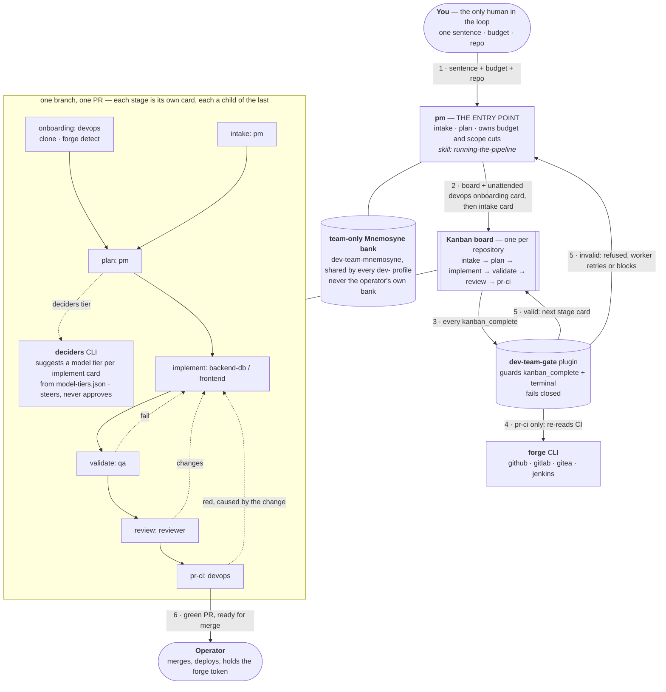

# dev-team: an autonomous software delivery team on Hermes kanban

Status: implemented, pending the CI workflow's own green run (`.github/workflows/dev-team.yml`
is in place; see [How it differs from `old/`](#how-it-differs-from-old)).

One sentence, a budget and a repository in. A pull request with green CI, marked ready for
human merge, out. No human in between unless a stop condition fires — merge and deploy are
always human, by design.

New to Hermes? Start with [How the dev team works](../docs/how-the-dev-team-works.md): what
gets installed, one request from start to finish, and where to look while it runs.

`dev-team` keeps Hermes kanban exactly as it is and adds what it doesn't have: an engine that
enforces "nothing is done without QA acceptance" instead of leaving it to an agent's judgment.
A change moves through six fixed stages. Each stage hands the next a small typed `metadata`
result. A stage cannot complete until that result is present and well-typed, and for CI, until
a fresh read from the forge confirms it. The full design, including what was rejected and why,
is in [`docs/superpowers/specs/2026-10-29-dev-team-design.md`](../docs/superpowers/specs/2026-10-29-dev-team-design.md).

## The pipeline



Rework loops back to a new `implement` card, not a fresh branch, up to a round limit of 3
(counted by the guard as 1 plus the rework cards in the ancestry, so a unit split into backend
and frontend implement cards still starts at round 1). A fourth round is refused; the worker must
block with `review: rounds-exhausted` instead.

## Profiles

Eight profiles, prefixed `dev-` by default (`--prefix` changes it) so they never collide with
`sdlc-team` or `outsourcing-team` profile names.

| Profile | Soul | Stages it works |
| --- | --- | --- |
| `pm` (entry point) | sdlc pm, unchanged | intake, plan — owns budget, scope cuts, reporting |
| `architect` | sdlc architect | plan (one-way-door decisions only, as a child card) |
| `uiux` | sdlc uiux | plan (when the change has an interface) |
| `backend-db` | sdlc backend-db | implement |
| `frontend` | sdlc frontend | implement |
| `qa` | sdlc qa | validate |
| `reviewer` | new | review |
| `devops` | sdlc devops | forge onboarding, pr-ci |

The reviewer soul is new: it reads the diff against the plan and acceptance criteria and judges
correctness, scope creep, risk and maintainability. It cannot approve its own work, write the
fix, or run the tests on the implementer's behalf.

## Stages

A stage is identified by the stage skill the card was created with
(`--skill dev-team-stage-<stage>`); the guard reads the stage from the card's skills, never
from its title or body. A card with no stage skill only skips the `kanban_complete` stage
checks — the merge/deploy and default-branch push blocks below still apply regardless.

| Stage | Assignee (prefixed: `<prefix><role>`, e.g. `dev-qa`) | Required `metadata` on `kanban_complete` |
| --- | --- | --- |
| `intake` | pm | `definition_of_done` (list), `budget` (`{amount, unit}`), `repo` |
| `plan` | pm | `cards` (ids of the implement cards it created, each verified to carry a stage skill) |
| `implement` | backend-db / frontend | `branch`, `head_sha`, `changed_files` (non-empty), `tests_run` (list of `{command, exit_code}`, at least one, every `exit_code` 0) |
| `validate` | qa | `head_sha` (must equal implement's), `verdict` (`pass`/`fail`), `evidence` (list); `fail` also needs non-empty `findings` |
| `review` | reviewer | `head_sha` (must equal validate's), `verdict` (`approve`/`changes`); `changes` also needs non-empty `findings` |
| `pr-ci` | devops | `pr_url`, `head_sha` (must equal review's), `ci` (`green`/`red`); `red` also needs non-empty `findings` — `green` is re-verified by the guard against the PR (in the project, head equals `head_sha`, ready) and its CI, not taken on the worker's word |

**The pr-ci green/red rule, as the guard (`dev-team-gate/guard.py`) implements it:** a
`pr-ci` card claiming `ci: "green"` is not believed. The guard reads the forge itself, in
this order: the claimed `pr_url` must be a pull request of the project (the project's own
forge reports that exact URL for its number), the PR's head must equal `head_sha`, CI on
`head_sha` must be `"green"`, and the PR must be marked ready. Anything else (another
repository's PR, a head pushed after review, `red`, `pending`, `none`, a draft, an unreachable
forge, a timeout) refuses the completion with a `pr:`, `ci:` or `forge: unreachable` label.
The guard does this in-process with the forge code shipped next to the plugin
(`dev-team/forge`, reached through the plugin link), never by running a `forge` it finds on
PATH; a plugin that was copied rather than linked cannot find that code and refuses every
green claim. Claiming green and retrying the same claim does not get past this; it fails
closed by construction, not by convention. `ci: "red"` is accepted at face value (the guard
does not re-verify a negative), and routes to exactly one new `implement` child card carrying
the `findings`, which counts as a rework round.

Besides `pr-ci`'s CI re-read, the guard checks on every `kanban_complete` of a guarded card:
the stage's required fields are present and well-typed; `head_sha` matches the parent stage
card's last completed run; exactly one child of the expected next stage exists in
`created_cards`, parented on this card; and the round limit (round 3: the first implement work
plus two rework cards in the card's
ancestry) isn't exceeded. Any exception, missing card, or unverifiable state is a refusal
naming what couldn't be checked — the guard fails closed, never open.

## Install flags

```bash
./dev-team/install-dev-team-unix.sh
```

```powershell
.\dev-team\install-dev-team-windows.ps1
```

| Unix | Windows | Effect |
| --- | --- | --- |
| `--model MODEL` | `-Model` | Set one model on every profile, overriding the per-role tier table (frontier for `pm`, `architect`, `reviewer`; mid for the rest). A real model id, never a tier word. |
| `--only a,b,c` | `-Only` | Create only these profiles (bare role names, unaffected by the prefix) instead of all eight. |
| `--prefix PREFIX` | `-Prefix` | Prepend `PREFIX` to every profile name (default `dev-`), e.g. `--prefix t2-` creates `t2-qa`. Letters, digits, hyphen and underscore only; an empty or invalid prefix exits 2 before any Hermes call. Use to run a second team alongside the first. The prefix is written to `<profile>/dev-team-prefix`, and the skills tell agents to build every card assignee from it (`<prefix>qa`, never a bare `qa`). |
| `--skip-model` | `-SkipModel` | Leave each profile's model at whatever it inherited. |
| `--keep-soul` | `-KeepSoul` | Do not overwrite an existing `SOUL.md`. |
| `--separate-memory` | `-SeparateMemory` | Give each profile its own Mnemosyne database instead of sharing the root one. Roles then cannot read each other's notes, so the board no longer hands work between them cleanly. |
| `--team-memory DIR` | `-TeamMemory` | Use `DIR` as the team's shared Mnemosyne bank instead of the default `$HERMES_ROOT/dev-team-mnemosyne`. Created if missing. `DIR` is made absolute before use (a relative value no longer becomes a dangling relative symlink or a bank created under the installer's cwd). Refused when it resolves to, is nested under, or contains the operator's own bank (`$HERMES_ROOT/mnemosyne`) or any `MNEMOSYNE_HOME` the operator has set — checked in both directions after canonicalising the path (`.`/`..` collapsed, every symlink/junction on it followed; a link cycle is refused). |
| `--adopt-team-memory` | `-AdoptTeamMemory` | For each existing profile that already has a real, private `mnemosyne/` directory: move it aside to `mnemosyne.pre-team-memory-<timestamp>` (a backup, never deleted), then link it to the team bank. Without this flag such a directory is kept, unlinked, and named in the summary. Either way, merging old private memories into the team bank is out of scope for this installer — that is on the operator. |
| `--forge-token-source COMMAND` | `-ForgeTokenSource COMMAND` | Record `COMMAND` as the `<prefix>devops` profile's forge-token helper (`secrets.command.command` + `secrets.command.enabled`), and append `DEV_TEAM_GH_TOKEN` to that profile's `terminal.env_passthrough`. **Unix only** — refused with exit 2 on the Windows installer, since Hermes' command secret source is POSIX-only; see [The forge token](#the-forge-token) below. |
| `--dry-run` | `-DryRun` | Print what would happen and change nothing. |

### The forge token

`pr-ci` needs a forge credential to push a branch and to talk to the forge, and it reads it from
**`DEV_TEAM_GH_TOKEN`** in its environment (`dev-team/skills/dev-team-stage-pr-ci/SKILL.md`).
`--forge-token-source COMMAND` is how the operator wires that up, once, at install time, **on the
Unix installer only**:

```bash
./dev-team/install-dev-team-unix.sh --forge-token-source 'printf "DEV_TEAM_GH_TOKEN=%s\n" "$(pass show forge/github-token)"'
```

`-ForgeTokenSource` on the Windows installer is refused outright (exit 2, nothing written):
Hermes' `command` secret source only ever resolves on POSIX (it shells out to `/bin/sh`), so the
flag would otherwise record devops profile config that Hermes running on Windows can never read —
a failure that would only surface much later as a `pr-ci` card blocking with "no forge token",
disconnected from its install-time cause. Wire the credential from a POSIX Hermes host with the
Unix installer instead, for example:

```powershell
# NOT supported: -ForgeTokenSource is refused on Windows. Run the Unix
# installer's --forge-token-source from a POSIX Hermes host, e.g.:
#   ./dev-team/install-dev-team-unix.sh --forge-token-source 'printf "DEV_TEAM_GH_TOKEN=%s\n" "$(op read op://dev/forge/token)"'
```

`COMMAND` must print a line `DEV_TEAM_GH_TOKEN=<value>` — Hermes' own secrets-command contract.
`pass show forge/github-token` and `op read op://dev/forge/token` print only the bare token, not
that line, so they must be wrapped as shown above (`printf 'DEV_TEAM_GH_TOKEN=%s\n' "$(...)"`) or
Hermes' dotenv parser finds nothing and the stage blocks silently. `COMMAND` containing a literal
token shape (`github_pat_…`, `ghp_…`, etc.) is refused outright — pass a command that *prints* the
token, never the token itself. Use a token that can open PRs and push feature branches but
**cannot merge and cannot push to the default branch** (see [Required
controls](#onboarding-a-project)).

What the installer writes, and nothing else:

- `secrets.command.command` and `secrets.command.enabled` on the `<prefix>devops` profile (the
  profile name is derived from the installed prefix, so a `--prefix t2-` install configures
  `t2-devops`) — both leaf keys are required: Hermes' `CommandSource` defaults `enabled` to
  `false`, so writing only `secrets.command.command` leaves the source disabled;
- `DEV_TEAM_GH_TOKEN` **appended** to that profile's `terminal.env_passthrough`, so a name
  already in that list is kept.

**Only the command string is stored, and this installer itself never executes `COMMAND`.** No
token value is ever fetched, printed, or written by the installer — not to a config, not to
stdout, and not under `--dry-run`. Once the source is enabled, though, **Hermes itself** runs the
helper once per `hermes -p <prefix>devops` process this install makes, at the start of that
process, with an empty key cache; Hermes discards the helper's stderr and never prints the value
it returns, so the token still never leaks, but it is no longer true that nothing ever runs
`COMMAND`. Re-running with the same `COMMAND` is a no-op, even over an already-correct mapping;
re-running with a different one replaces only `secrets.command.command`. The flag only has a
target when `devops` is in the run: with `--only` excluding it, the installer says so on stderr
and writes nothing for it. The list merge itself is `dev-team/scripts/env_passthrough_merge.py`,
shared by both installers.

Without this flag nothing about the token changes, and a `pr-ci` card with no
`DEV_TEAM_GH_TOKEN` blocks with `setup: no-forge-token` rather than reaching for any fallback
credential.

Both installers are idempotent (re-running upgrades the SOUL, model, plugin link and skills in
place), refuse when the root profile's `memory.provider` isn't `mnemosyne`, link the
`dev-team-gate` plugin and Mnemosyne data into every profile, enable the kanban toolset, and
install the stage skills plus `running-the-pipeline` and `kanban-budget.py` on `pm`. They also
put `forge` where the gateway resolves it — `~/.local/bin/forge` on Unix, `forge.cmd` beside
`hermes.exe` on Windows — and verify Mnemosyne `available` and the gate plugin loaded for every
profile, exiting non-zero otherwise. The plugin checks are retried for a few seconds first, because
right after `plugins enable` the list can lag the reload. If a `forge` already exists there and
this installer didn't write it (Laravel Forge, Foundry), the installer refuses before it touches
any profile; move the other tool aside and re-run. On Windows, `forge.cmd` and `deciders.cmd` name
the Python and the dev-team checkout by absolute path, and cmd.exe reads a `.cmd` file in the
console code page, so neither path can be literally non-ASCII in the file. The installer picks the
first Python it finds (Hermes's own under `%LOCALAPPDATA%\hermes\tools`, then `py -3`, then
`python` on PATH), regardless of whether its path is ASCII. A non-ASCII path is then embedded as an
`%ENVVAR%` prefix (`%LOCALAPPDATA%`, `%APPDATA%`, `%USERPROFILE%`, `%ProgramFiles%`, or a persisted
`HERMES_ROOT`) plus an ASCII remainder — cmd.exe expands the variable from its own environment at
run time, so a non-ASCII user name and a dev-team checkout under the user's profile now install
normally, with a guard in the wrapper that fails clearly if the expanded path doesn't exist (e.g.
run under a different user). Only when a non-ASCII path sits under none of those folders does the
installer still exit 2 before touching any profile, naming the offending path: install a Python 3
(and/or move the checkout) onto an ASCII path (such as `C:\Python312`) or under one of those
folders, then re-run.

Both installers check every `MNEMOSYNE_HOME`/`MNEMOSYNE_DATA_DIR` value they pin with
`dev-team/scripts/env_pin_check.py`, run on the resolved value, and refuse (exit 2) any value
Hermes's and Mnemosyne's `.env` readers would not both read back exactly.

**The team's shared memory bank is a dedicated directory**, `$HERMES_ROOT/dev-team-mnemosyne`
(Windows: `Join-Path $HermesRoot 'dev-team-mnemosyne'`), created when missing. Every installed
profile's `mnemosyne` links there unless `--separate-memory`/`-SeparateMemory` was passed. **The
operator's own bank — `$HERMES_ROOT/mnemosyne`, any `MNEMOSYNE_HOME`, and any `MNEMOSYNE_DATA_DIR`
the operator has set (including the Windows User-scope value the Mnemosyne installer persists
after a `MNEMOSYNE_HOME`-based relocation) — is never linked into, read from, or written to by
this installer**; none of those variables select the team bank, and `--team-memory`/`-TeamMemory`
refuses a value that resolves to, is nested under, or contains the operator's own bank,
`MNEMOSYNE_HOME`, or `MNEMOSYNE_DATA_DIR` (checked in both directions, and by filesystem identity —
not just path string — so a bind mount is caught too, exercised by
`test_team_memory_flag_refuses_an_alias_via_bind_mount` on Unix and
`test_team_memory_refuses_an_alias_via_bind_mount` under the pwsh harness, both skipped cleanly
without an unprivileged bind mount (`unshare --mount --map-root-user`). The same device/inode
identity check should also catch a Windows 8.3 short name or a `subst` drive, but neither has an
automated test here). `--team-memory` is also refused if it resolves under `$HERMES_ROOT/profiles` or
`$HERMES_ROOT/dev-team`: either would break every profile's own link. The value is canonicalised
before the check, and the canonical form is what gets created and linked: made absolute,
`.`/`..`/repeated separators collapsed (also in the part that does not exist yet, so
`$HERMES_ROOT/nonexist/../mnemosyne` is refused and `nonexist` is never created), and every
symlink/junction anywhere on the path — live or dangling — followed, with a link cycle refused
(exit 2). A relative value therefore cannot become a dangling relative symlink or create the bank
under the installer's working directory. `--adopt-team-memory`/`-AdoptTeamMemory` canonicalises
the profile directory and its `mnemosyne` before any move, and refuses rather than acts if the
profile directory resolves outside `$HERMES_ROOT/profiles`, if `mnemosyne` resolves to the
operator's own bank, or if it already is the team bank; an existing backup path (a directory or a
link) is never merged into — a new, unique name is picked instead. `--dry-run`/`-DryRun` with
`--adopt-team-memory` prints `would back up: <dir> -> <backup>` for each private bank it would
move. On a re-run, a profile whose `mnemosyne` link pointed at, into, or above either operator
location is repointed with a NOTE. A profile this run creates gets its `mnemosyne` directory (the
one `profile
create --clone` makes) replaced by a link to the team bank. A profile that already existed and
has a real `mnemosyne` directory keeps it by default and is named in the final summary; pass
`--adopt-team-memory`/`-AdoptTeamMemory` to move that directory aside as a timestamped backup
(never deleted) and link it to the team bank instead — the installer never merges its old
memories into the team bank itself. Symlinks on Unix become
directory junctions on Windows (no Developer Mode or elevation needed), falling back to a copy
with a warning when even a junction can't be created. On a re-run an existing junction is
removed with `[System.IO.Directory]::Delete` and never with `Remove-Item -Recurse`. On Windows
PowerShell 5.1 that cmdlet follows the junction and deletes the team bank's contents.

**`MNEMOSYNE_DATA_DIR` is the variable that actually decides the CLI's and the call-time modules'
data directory** — `mnemosyne/cli.py:20-23`, and `core/banks.py`, `core/triples.py`,
`core/canonical.py` and `core/media.py` all check it before anything else. It does **not**,
however, decide the Hermes provider's own main database: Hermes always injects `hermes_home`
(`agent/memory_manager.py:920-923`), the provider builds that DB's path explicitly as
`$HERMES_HOME/mnemosyne/data/…` (`mnemosyne_hermes/__init__.py:2690-2721`), and `BeamMemory`
itself resolves an explicit path ahead of either env var (`mnemosyne/core/beam.py:5960`) — so the
provider's main DB always follows the per-profile `mnemosyne/` link this installer sets up,
regardless of `MNEMOSYNE_DATA_DIR`.

**`MNEMOSYNE_HOME` is read by the installed Mnemosyne package itself** — contrary to an earlier
version of this document — for the MCP shared-surface DB and federation:
`mnemosyne/mcp_tools.py:167-173` builds the shared-surface DB path from it, and so do
`core/fleet_census.py:149-155` and `core/federation_handshake.py:262-267`. (`mcp_server.py:811`
also reads `MNEMOSYNE_HOME`, but only to locate a `.env` file to auto-load for the MCP server
process — `_load_dotenv`, `:793-812` — not to build a DB path.) If
either `MNEMOSYNE_HOME` or `MNEMOSYNE_DATA_DIR` is set in the shell or gateway environment a
`hermes -p dev-*` process launches from, it silently overrides this installer's links, the same
way a live operator session was found to leak the operator's own bank into a `dev-pm` chat
despite `profiles/dev-pm/mnemosyne` pointing at the team bank. This installer closes that gap by
pinning **both** `MNEMOSYNE_DATA_DIR` and `MNEMOSYNE_HOME` into each profile's own `.env` file:
Hermes loads a profile's `.env` with `override=True` specifically so it beats a value already in
the process environment (`hermes_cli/env_loader.py:502-562`).

**The pinned `.env` values do not win regardless, though: they do nothing in a multiplex
gateway, a routed cron fire, or a managed worker.** While a routed profile-home override is
active — which also covers a routed cron fire in the desktop backend
(`cron/scheduler_provider.py:95-105`, `routed_profile_fire`) — the gateway deliberately skips
loading that profile's own `.env` into the shared process environment, to avoid exposing one
profile's credentials to sibling turns (`env_loader.py:530-545`). A managed worker never reaches
that load at all: Kanban's worker client hands the turn to the profile's **owner** process rather
than running an agent of its own, and `bind_worker_policy` freezes that owner's assignment
process-wide before any config import (`agent/managed_worker.py:129-143`); correspondingly,
`load_hermes_dotenv` returns before opening any `.env` once `worker_config_snapshot()` is set
(`hermes_cli/env_loader.py:510-515`). So a dev-team profile run through a multiplex gateway, fired
by a routed cron job, or spawned as a managed worker all still inherit whatever
`MNEMOSYNE_HOME`/`MNEMOSYNE_DATA_DIR` the parent process itself was launched with — the `.env`
pin only protects a profile launched directly and un-routed, such as `hermes -p dev-pm chat` run
from a shell with no multiplex override active. **The gateway process, every cron-firing process,
and every non-routed `hermes -p dev-*` launch should still run with `MNEMOSYNE_HOME` and
`MNEMOSYNE_DATA_DIR` unset.**

## Onboarding a project

Each repository gets its own board and its own forge project record — the hard isolation
boundary workers cannot see past. `pm`'s `running-the-pipeline` skill sequences a `devops`
onboarding card *before* the first `implement` card ever runs, so the team's own clone and the
project record exist first. The pm sets the board's `default_workdir` at creation time —
deterministic, pointing at the clone path devops will create — so onboarding never has a
step that sets or changes it.

`$HERMES_HOME` is set per installed profile, but every profile's `dev-team` directory is a
symlink into the same shared tree, so resolve the canonical team-home path with `pwd -P` before
using it — a raw `$HERMES_HOME/dev-team/...` string differs across profiles even when it names
the same real directory:

```bash
TEAM_HOME="$(cd "$HERMES_HOME/dev-team" && pwd -P)"
hermes kanban boards create <repo-slug> --name "<repo> dev-team pipeline" --default-workdir "$TEAM_HOME/repos/<repo-slug>"
```

Every later `hermes kanban` command that targets this board must name it explicitly with
`--board <repo-slug>`. Nothing in the team runs `hermes kanban boards switch` — it mutates the
machine-wide current board, shared across every repository and the operator's own session.

Then devops runs `forge detect`, pointed at the team's own clone — never the operator's own
checkout:

```bash
forge detect --repo-dir "$TEAM_HOME/repos/<repo-slug>/" --slug <repo-slug>
```

`--slug` must be passed explicitly with intake's `repo` string; without it, `detect` falls back
to the clone directory's name. A slug containing `/` or `\`, or equal to `.` or `..`, is
refused. `detect` writes the whole project record itself
(`$TEAM_HOME/projects/<repo-slug>.json`): the PR and CI adapters, `repo_url` from the
clone's `git remote get-url origin` (credentials in the URL stripped), and `default_branch`
from `git symbolic-ref refs/remotes/origin/HEAD` (run `git remote set-head origin --auto` first
if that ref is missing). Never hand-edit the record. `detect` refuses to overwrite an existing
record unless the operator passes `--force`. Exit 2 with `"ambiguous: pass --pr-adapter"`
means devops decides and re-runs with `--pr-adapter`/`--ci-adapter` explicitly. Devops compares
the board's `default_workdir` against its own clone path by resolved real path (`realpath` both
sides, trailing slash ignored), never by raw string — the two values are produced by different
profiles' shells. If the resolved paths differ, or `default_workdir` is missing, devops blocks
with a clear reason instead of changing the board.

**The terminal guard is a seatbelt against mistakes, not a security boundary.** It reads
shell commands as text — tokenised, not matched by substring, so it catches shell nesting,
`sh -c`, `eval`, aliases and command substitution — but text analysis of a command string can
never be a complete barrier against a determined or merely creative agent. Treat every refusal
below as "this mistake is now hard to make by accident", not as "this is impossible".

**Required controls (the real boundary).** These are the operator's responsibility, not the
plugin's, and the pipeline is not safe to run without them:

- **Branch protection on the default branch, with no bypass.** No direct pushes, no force
  pushes, changes only through a reviewed PR, and no "administrators can bypass" exception —
  a bypass available to anyone is available to an agent that finds it.
- **A team forge token without merge rights.** A bot account scoped to open PRs and push
  feature branches, never one that can merge or push to the default branch. Provision it via
  each vendor CLI's own login or the operator's `secret` store, independent of anything the
  plugin catches.
- **`forge/`, the plugin, the project records and `kanban.db` owned by the operator and
  read-only to the agents' user.** The guard trusts `dev-team/forge/` (the CI/PR adapters it
  imports), the `dev-team-gate` plugin (including its symlink in each profile) and
  `$HERMES_HOME/dev-team/projects/*.json` (the project records: `default_branch`, forge
  adapters, CI hints) to decide what "the default branch" and "green CI" even mean. Anything
  that can write those files as the agents' own user can rewrite those decisions, and no text
  check from inside the same process can defend against that — OS-level read-only permissions
  (or a sandboxed agents' user) are what actually stop it. Running the agents' user and the
  operator's own shell as the same OS user defeats this regardless of what the guard refuses.

**What the guard covers.** It checks every `terminal` call in a dev-team profile — guarded
card or not, and even before any board lookup. It refuses:

- merge and deploy commands: `gh pr merge`, `glab mr merge`, `tea pr merge`, `gh|glab|tea api`
  and `curl`/`wget` writes to a `/merge`, `git/refs` or `/contents/` endpoint (walking `curl`'s
  short-option clusters letter by letter, e.g. `-sXPUT`), a `gh api graphql` mutation that
  merges or rewrites a ref (including `createCommitOnBranch`), `gh alias set` whose body
  contains `pr merge`, `kubectl apply|rollout|delete|patch|replace|scale|edit|set image`, `helm
  upgrade|install|rollback|uninstall`, `terraform apply|destroy`, `docker|podman push`,
  `docker buildx build|bake --push`;
- a `git push` to the default branch (normalised the way git resolves it: `heads/main` and
  `refs/heads/main` are `main`) or to a branch argv cannot name; `git subtree push`, `git
  send-pack`, `git-push` and other dashed builtins; `git -c` / `--config-env` / `GIT_CONFIG_*`
  and `git config` writes of `alias.*`, `remote.*`, `push.*`, `branch.*`, `include.*` and
  `url.*`; `git branch --set-upstream-to`; and a `git` subcommand that is not a builtin
  (it may be an alias);
- commands it cannot see into: a script fed to a shell or interpreter on stdin or a
  here-string (`… | sh`, `bash <<<…`, `python3 - <<EOF`), a command name that is a shell
  expansion (`$g push …`), `env -S`, shell function definitions, inline interpreter code that
  mentions push/merge/kanban;
- removing a fence: `env -u HERMES_*`, `env -i`, `unset HERMES_*`, `HERMES_*=… cmd`,
  `export HERMES_*=`, and the PowerShell equivalents;
- `hermes kanban complete|request-changes|edit|unblock|reopen-review|promote|request-review|
  archive|assign|reassign|reclaim|link|unlink`, in any form (including `python3 -m
  hermes_cli.main kanban …`), when **any** target card (every positional, parsed with Hermes'
  own `kanban` argparse tree when `hermes_cli` can be imported, so an abbreviated option like
  `--ti` cannot shift the target; otherwise with a strict fallback that refuses any option not
  on an exact allowlist) is a
  dev-team card or cannot be read, from any caller; `hermes kanban unblock|promote` of a card
  blocked with kind `needs_input` additionally refuses regardless of whether that card is a
  dev-team card at all, since `promote` is also an unblock and only the operator releases a
  `needs_input` block.

**Known uncovered classes (not fixed, by design).** These remain open; do not rely on the
guard for them:

- **Writes to git config files.** `.git/config`, `~/.gitconfig`, `$XDG_CONFIG_HOME/git/config`
  and `.git/hooks/*` can redirect a `git push` or define an alias just as effectively as `git
  config`/`git -c`, but an ordinary file write to those paths (`printf … >> .git/config`, a
  text editor, `sed -i`) is not inspected.
- **Relative-path writes to a trusted location.** The protected-path check is text matching on
  each argv word. `.local/bin/forge`, `forge.cmd`, `dev-team/projects` and
  `plugins/dev-team-gate` are refused wherever they appear. `dev-team/forge` and
  `dev-team/plugin` are refused only when a path separator precedes them, so a bare relative
  word such as `git diff -- dev-team/forge/` stays allowed for ordinary work on *this*
  repository. Two consequences follow:
  - `cd $HERMES_HOME/dev-team && echo '{}' > projects/widgets.json` reaches a protected file
    through a relative path and is not caught.
  - Ordinary paths written with a separator in front, such as `./dev-team/forge/` or an
    absolute path into a clone of this repository, are refused even though they are harmless.
    Use the bare relative form.
- **Script files.** `sh p.sh`, `python3 script.py`, `./run.sh` run whatever the file contains
  with no inspection at all; only a stdin script or a `-c`/`-e` inline script is checked.
- **Non-terminal tools.** Only the `terminal` tool is checked. Code execution
  (`execute_code`-style tools), file-writing tools, browser or HTTP tools, and any MCP tool
  that is not `terminal` or `kanban_complete` are not inspected at all.

## Running it

- **The board.** Every command names its board explicitly: `hermes kanban --board <repo-slug>
  ls`, `hermes kanban --board <repo-slug> show <id>` (see Onboarding a project, above — nothing
  in the team switches the machine-wide current board). A card's guarded stage is whatever
  `dev-team-stage-<stage>` skill it carries — check that, not the title, when in doubt.
- **Talking to pm.** Give `pm` one sentence, a budget and a repository; its soul's own
  **Intake: Turning One Line Into A Plan** section drives everything else. From intake it
  creates the `plan` card, and from there each stage's own skill creates its required child —
  pm does not hand-drive the routing.
- **Budget.** `pm` runs `dev-team/scripts/kanban-budget.py` at the 25/50/75% checkpoints its
  soul defines, on the current board: `--set-budget <USD>` once right after intake, then bare
  for a checkpoint read, `--json` for the ledger. **The script's exit code is the gate, not the
  number:** 0 is fine; 1 means into the closeout reserve (apply the degradation ladder — never
  skip QA or ship untested work to preserve scope); 2 means exhausted — block every open card
  on the board with `budget: exhausted` and stop opening new ones. Budget is pm's judgment
  call, never the guard's: the script's spend figure is an inference (it correlates run windows
  against profile sessions), and a guard must never block on an inference.

## Attention labels

Every `kanban_block` on this pipeline starts with a failure-class label, so pm's ledger
(`hermes kanban --board <repo-slug> ls --status blocked`) can count recurring classes instead of
treating three occurrences as three unrelated incidents:

| Label | Meaning |
| --- | --- |
| `intake: no-testable-dod` | The one-liner plus reasonable assumptions still doesn't resolve into a testable definition of done. |
| `budget: missing` / `budget: insufficient` / `budget: exhausted` | No usable budget number/unit; the number can't cover the Must tier plus mandatory reserves; or the checkpoint script exited 2. |
| `scope: ...` | A load-bearing ambiguity about what's in or out. |
| `plan: card-missing-skill` | A card meant to carry a stage skill doesn't. |
| `architecture: one-way-door` | The architect's child card flagged or refused an irreversible decision. |
| `implement: ambiguous-spec` | The plan or findings don't resolve into buildable work. |
| `implement: blocked-dependency` | Something outside this branch must change first. |
| `qa: environment-unreachable` | The change can't be exercised to produce any verdict. |
| `review: self-review` | The reviewer authored or materially edited the change under review. |
| `review: rounds-exhausted` | The guard refused a 4th `implement` round. |
| `ci: other` | A CI state that doesn't resolve to green/red-caused-by-the-change, or a poll timeout. |
| `forge: unreachable` | The forge adapter itself can't be reached or verified. |
| `forge: record-stale` | The project record is wrong (repository moved, default branch changed); only the operator re-runs `forge detect --force`. |
| `pr: not-in-project` / `pr: head-mismatch` / `pr: not-ready` | A green `pr-ci` claim whose PR is not the project's, whose head is not the reviewed `head_sha`, or which is still a draft. |
| `setup: no-prefix` | The profile has no `dev-team-prefix` file, so assignee names cannot be built. |
| `merge: human-only` | A terminal call tried to merge, deploy, or push to the default branch. |
| `guard: ...` | A terminal call the guard cannot verify, that removes a fence, or that writes into the forge, the plugin or the project records. |

Any specialist soul's own stop conditions (an invalidated assumption, an irreversible action,
another specialist's refusal) are blocked with the same label convention.

## How it differs from `old/`

`old/sdlc-team/` and `old/outsourcing-team/` coordinate through the same Hermes kanban, but
every rule — "nothing is done without QA acceptance," "stop after three failures," "never
merge without authorization" — is enforced only by an agent's judgment, written into a SOUL or
a skill. `dev-team` keeps that same kanban and adds a Hermes plugin
(`dev-team-gate`) that enforces the governance mechanically at the one boundary every worker
must cross: `kanban_complete`. Concretely:

- A card cannot reach `done` because the agent said so while the check it needed never ran —
  the guard validates every stage's `metadata` by type, carries `head_sha` forward from parent
  to child, and re-reads CI from the forge itself rather than trusting the claim.
- Unknown failures pause as labelled attention items (above) instead of being improvised
  around.
- `forge`, a vendor-neutral stdlib CLI with adapters for GitHub, GitLab, Gitea and Jenkins,
  replaces vendor-specific commands in every soul and skill — no vendor name leaks into the
  guard's logic or the stage skills except `dev-team-stage-pr-ci`, the one stage allowed to
  name `forge` itself.
- Merge and deploy are structurally unreachable rather than merely discouraged: `forge` has no
  merge or deploy subcommand, and the guard additionally blocks known merge/deploy commands and
  the kanban side-door verbs (`hermes kanban complete`/`request-changes`/`edit`/`unblock`/
  `reopen-review`) that would otherwise finish a guarded card without going through the
  `kanban_complete` hook at all.
- `old/` is frozen and not maintained; new work goes into `dev-team/`, which is the
  installers' current, maintained team.

CI for this branch (`.github/workflows/dev-team.yml`: unit tests for `forge` and
`dev-team-gate`, plus install-and-reinstall idempotency checks on Linux and Windows) is wired
up but its own green run on this branch is still pending as of this card — see the root design
doc and the operator's own run of the workflow for current status.
