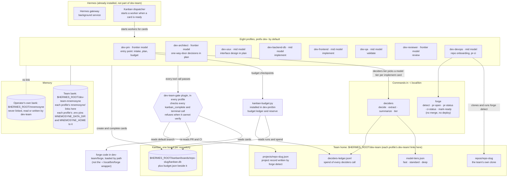
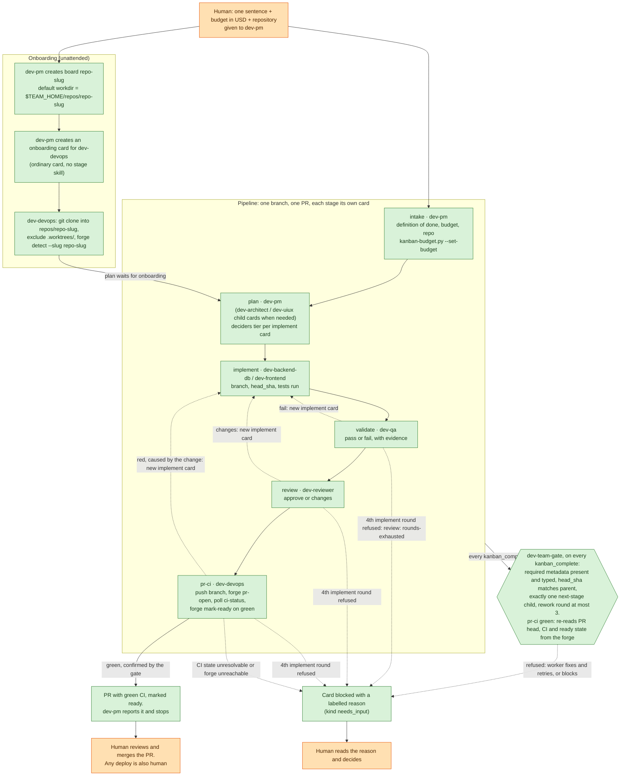

# How the dev team works

This page explains `dev-team` for someone who has never used Hermes. It covers what the
installer puts on your machine, what happens to one request from start to finish, what the
team promises never to do, and where to look while it runs. The full reference is
[`dev-team/README.md`](../dev-team/README.md).

**The words used below.** *Hermes* is the agent runtime. A *profile* is one named Hermes agent
with its own model, instructions (its `SOUL.md`), skills and settings. A *kanban board* is the
task list the profiles share. A *card* is one task on that board, and each card is assigned to
one profile. Hermes' *dispatcher* starts a worker for a card when the card is ready. *Mnemosyne*
is the memory store the profiles read and write. A *forge* is the place your code is hosted and
built (GitHub, GitLab, Gitea, Jenkins).

In short: you give the `dev-pm` profile one sentence, a budget and a repository. The team plans
the change, builds it, tests it, reviews it and opens a pull request with green CI, marked ready
for review. Merging it, and any deploy, is always done by a human.

## 1. What is installed on the machine

`dev-team/install-dev-team-unix.sh` (Windows: `dev-team/install-dev-team-windows.ps1`) sets
this up on top of an existing Hermes + Mnemosyne install. The gateway and the dispatcher belong
to Hermes itself. The installer uses them but does not install them.

What each piece is, with the file that sets it up:

| Piece | What it does | Source |
| --- | --- | --- |
| Eight profiles | `pm architect uiux backend-db frontend qa reviewer devops`, each named with the prefix (`dev-` by default; `--prefix` changes it). Each gets its own `SOUL.md` from `dev-team/souls/`. | `dev-team/install-dev-team-unix.sh:252-262`, `:31` |
| Model per profile | Frontier tier (`anthropic/claude-opus-5`) for pm, architect, reviewer. Mid tier (`anthropic/claude-sonnet-5`) for the rest. `--model` sets one model on every profile instead. | `dev-team/install-dev-team-unix.sh:13-20`, `:1226-1238` |
| `deciders` and the tier table | A small CLI for cheap bounded calls. When pm creates an implement card, `deciders tier` suggests `fast`, `standard` or `deep`. pm decides the final tier and takes the model for that tier from `model-tiers.json`. Deciders steer and never approve. | `dev-team/install-dev-team-unix.sh:321-335`, `:1122-1136`; `dev-team/skills/dev-team-stage-plan/SKILL.md:38-63`; `dev-team/skills/dev-team-deciders/SKILL.md:20-25` |
| `dev-team-gate` plugin | A Hermes `pre_tool_call` hook, linked and enabled in every profile. It looks only at `kanban_complete` and `terminal`. | `dev-team/plugin/dev-team-gate/plugin.yaml`; `dev-team/plugin/dev-team-gate/guard.py:1735-1738`; `dev-team/install-dev-team-unix.sh:1420-1421` |
| `forge` | A forge-neutral CLI with GitHub, GitLab, Gitea and Jenkins adapters. Its subcommands are `detect`, `pr-open`, `pr-status`, `ci-status` and `mark-ready`. It has no merge or deploy subcommand. | `dev-team/forge/forge_core.py:337-359`; `dev-team/install-dev-team-unix.sh:307-320`, `:1494-1497` |
| Kanban board per repo | pm creates one board per repository. A board other than `default` keeps its database at `$HERMES_ROOT/kanban/boards/<slug>/kanban.db`. | `dev-team/skills/running-the-pipeline/SKILL.md:23-49`; `dev-team/scripts/kanban-budget.py:100-104` |
| Team home | `$HERMES_ROOT/dev-team`. Every profile's `dev-team/` links to it, so all profiles share the same clones, project records, tier table and deciders ledger. | `dev-team/install-dev-team-unix.sh:803`, `:1394-1402`; `dev-team/deciders/deciders_core.py:146-148` |
| Team clones | `$TEAM_HOME/repos/<repo-slug>/`, cloned by devops during onboarding. The team never works in your own checkout. | `dev-team/skills/dev-team-stage-pr-ci/SKILL.md:28-36` |
| Team-only memory bank | `$HERMES_ROOT/dev-team-mnemosyne` (`--team-memory` sets a different location at install time). Each profile's `mnemosyne/` links to it, and each profile's `.env` pins `MNEMOSYNE_DATA_DIR=<bank>/data` and `MNEMOSYNE_HOME=<bank>`. | `dev-team/install-dev-team-unix.sh:554-560`, `:776-794`, `:1309` |
| Budget ledger | `kanban-budget.py`, copied to `dev-pm/bin/`. It adds up spend for a board and compares it with the budget in `budget.json`. | `dev-team/install-dev-team-unix.sh:1468-1485`; `dev-team/scripts/kanban-budget.py:318-319`, `:332-410` |
| The forge credential | Optional, and the operator's to supply, **Unix only**: `--forge-token-source COMMAND` records `COMMAND` as the `<prefix>devops` profile's forge-token helper (`secrets.command.command` and `secrets.command.enabled`) and adds `DEV_TEAM_GH_TOKEN` to that profile's `terminal.env_passthrough`. `COMMAND` must print `DEV_TEAM_GH_TOKEN=<value>` and must not itself contain a literal token shape (refused). Only the command **string** is stored — this installer itself never runs `COMMAND`, but once the source is enabled Hermes runs it at the start of every later `hermes -p <prefix>devops ...` call in the install and discards its stderr, so no value is printed; `--dry-run` writes nothing either. `-ForgeTokenSource` on the Windows installer is refused outright (exit 2, nothing written): Hermes' command secret source is POSIX-only. | `dev-team/install-dev-team-unix.sh` (`configure_forge_token_source`); [`dev-team/README.md`, "The forge token"](../dev-team/README.md#the-forge-token) |

**One caveat about the `.env` pins.** They only work when a profile is started directly, for
example `hermes -p dev-pm chat`. They have no effect in a multiplex gateway, a routed cron fire
or a managed worker. Those inherit the parent process's environment, so the gateway itself
must run with `MNEMOSYNE_HOME` and `MNEMOSYNE_DATA_DIR` unset. Details:
[`dev-team/README.md`, "Install flags"](../dev-team/README.md#install-flags).

## 2. One request, start to finish

Legend: **green boxes run automatically** (an agent or the gate, with no human involved).
**Orange boxes are human-only.** Dashed arrows are rework loops and stop conditions. Each solid
arrow between two stages is a `kanban_complete` that the gate has accepted.

Step by step, with sources:

1. **The human asks pm** with one sentence, a budget and a repository, then leaves.
   `dev-team/skills/running-the-pipeline/SKILL.md:8-12`.
2. **pm onboards the repository** without asking anyone. It creates the board with
   `--default-workdir` already pointing at the clone path devops will create. Then it creates an
   ordinary onboarding card for devops, which clones the repo, excludes `.worktrees/` and runs
   `forge detect`. Devops never changes the board. If the paths don't match, devops blocks
   instead. Plan cannot start until onboarding is done.
   `dev-team/skills/running-the-pipeline/SKILL.md:23-75`;
   `dev-team/skills/dev-team-stage-pr-ci/SKILL.md:28-61`.
3. **Six stages**: intake, plan, implement, validate, review, pr-ci. Each stage is its own card,
   created as a child of the previous one. The card's stage is read from its
   `dev-team-stage-<stage>` skill. `dev-team/README.md` ("Stages");
   `dev-team/plugin/dev-team-gate/stages.py:26` (stage from skills), `:206-219` (next-stage child).
4. **Rework** happens when validate fails, review asks for changes, or CI is red because of the
   change. Each of these creates a new `implement` card on the same branch. The limit is 3
   rounds, and the gate refuses a 4th. `dev-team/plugin/dev-team-gate/guard.py:39`, `:157-167`;
   `dev-team/plugin/dev-team-gate/stages.py:209-219`.
5. **The gate checks every `kanban_complete`** on a stage card: the required metadata, the
   `head_sha` carried over from the parent card, exactly one next-stage child, and the round
   limit. For a pr-ci card that claims `ci: "green"`, it reads the forge itself: is the PR in
   this project, is its head the reviewed `head_sha`, is CI green, is the PR marked ready? If it
   cannot check something, it refuses. `dev-team/plugin/dev-team-gate/guard.py:56-176`;
   `dev-team/skills/dev-team-stage-pr-ci/SKILL.md:95-104`.
6. **The PR is marked ready** (`forge mark-ready`). pm reports it and stops. No stage comes after
   pr-ci. `dev-team/skills/dev-team-stage-pr-ci/SKILL.md:78`, `:118-119`;
   `dev-team/skills/running-the-pipeline/SKILL.md:131-138`.
7. **A human merges.** `dev-team/skills/dev-team-stage-pr-ci/SKILL.md:140-147`.

## 3. What the team guarantees

- **The reviewer is never the implementer.** Review cards go to `dev-reviewer`, implement cards
  go to `dev-backend-db` or `dev-frontend`. These are separate profiles with separate souls
  (`dev-team/install-dev-team-unix.sh:252-262`). If the reviewer wrote or substantially edited the
  change, it has to stop and block with `review: self-review`. It may not approve
  (`dev-team/souls/SOUL-reviewer.md:64`, `:108`;
  `dev-team/skills/dev-team-stage-review/SKILL.md:59`, `:66`). This rule lives in the
  reviewer's soul and skill. The gate does not check who wrote the code. What it does check is
  that the review approves the same `head_sha` that QA validated
  (`dev-team/plugin/dev-team-gate/guard.py:42`).
- **Merge and deploy are human-only.** `forge` has no merge or deploy subcommand
  (`dev-team/forge/forge_core.py:337-359`). The gate refuses known merge and deploy commands,
  pushes to the default branch, and `hermes kanban` commands that would move a guarded card
  without going through `kanban_complete`
  (`dev-team/plugin/dev-team-gate/guard.py:261-270`, `:1518`). The gate is a seatbelt, not a
  security boundary. The real controls are branch protection with no bypass and a forge token
  that cannot merge. These are the operator's job
  ([`dev-team/README.md`, "Required controls"](../dev-team/README.md#onboarding-a-project)).
- **Fences block and ask.** When a worker hits something it cannot verify or must not do, it
  blocks the card with `kind="needs_input"` and a labelled reason. It does not work around the
  problem. The gate refuses commands that try to remove a Hermes fence, and it refuses to
  release a `needs_input` block. Only the operator releases one
  (`dev-team/plugin/dev-team-gate/guard.py:1158-1164`, `:1484-1515`;
  `dev-team/skills/dev-team-stage-pr-ci/SKILL.md:132-136`).
- **The budget reserve.** By default, `kanban-budget.py` holds back 15% of the budget as a
  closeout reserve for QA, handover and the ledger (`--reserve-pct`). Exit code 1 means spend
  has reached the reserve, so pm cuts scope but never skips QA. Exit code 2 means the budget is
  used up, so pm blocks every open card with `budget: exhausted`
  (`dev-team/scripts/kanban-budget.py:332-410`, `:425-426`;
  `dev-team/skills/running-the-pipeline/SKILL.md:101-112`). This is pm's call, not the gate's,
  because the spend figure is an estimate.
- **The operator's own memory bank is untouched.** The team uses its own bank. The installer
  never links into, reads or writes `$HERMES_ROOT/mnemosyne`, `MNEMOSYNE_HOME` or
  `MNEMOSYNE_DATA_DIR`. It refuses a `--team-memory` value that resolves to, sits inside, or
  contains any of them (`dev-team/install-dev-team-unix.sh:351-354`, `:548`, `:595`,
  `:1296-1320`).

## 4. Where to look

Replace `<slug>` with the repository's board slug and `<id>` with a card id. `$HERMES_ROOT` is
your Hermes home, `~/.hermes` by default.

| What | Command or path |
| --- | --- |
| The board | `hermes kanban --board <slug> ls`. The database is at `$HERMES_ROOT/kanban/boards/<slug>/kanban.db` (`dev-team/scripts/kanban-budget.py:100-104`). |
| One card | `hermes kanban --board <slug> show <id>` (comments, events, the block reason word for word). Runs: `hermes kanban --board <slug> runs <id>`. |
| What needs a human | `hermes kanban --board <slug> ls --status blocked`. Every reason starts with a label from [Attention labels](../dev-team/README.md#attention-labels). |
| Budget ledger | `python3 dev-team/scripts/kanban-budget.py --board <slug>` (pm's copy: `$HERMES_ROOT/profiles/dev-pm/bin/kanban-budget.py`). Add `--json` for machine-readable output. The budget is in `$HERMES_ROOT/kanban/boards/<slug>/budget.json`. Deciders spend is in `$HERMES_ROOT/dev-team/deciders-ledger.jsonl` (`dev-team/scripts/kanban-budget.py:240-248`, `:318-319`). |
| Worker logs | `hermes kanban --board <slug> log <id>` (`--tail N` for the last N bytes). To follow the card's event stream (not the worker log): `hermes kanban --board <slug> tail <id>`. These are Hermes CLI commands, see `hermes kanban --help`. |
| Project record | `$HERMES_ROOT/dev-team/projects/<slug>.json`, written by `forge detect`. Never edit it by hand (`dev-team/skills/dev-team-stage-pr-ci/SKILL.md:28-45`). |
| The team's clone | `$HERMES_ROOT/dev-team/repos/<slug>/`. |
